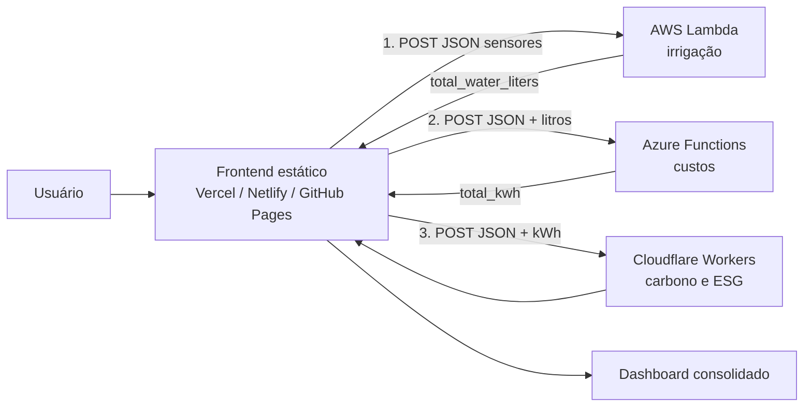

# Arquitetura

**Orquestração no cliente:** o navegador encadeia as chamadas (sem backend próprio, VMs ou contêineres gerenciados). Cada cálculo definitivo acontece na função de nuvem correspondente; o frontend só valida entradas básicas, apresenta dados e (opcionalmente) roda a simulação local rotulada.

## Dependências entre dados
| Passo | Entrada vinda do anterior | Saída usada pelo seguinte |
|---|---|---|
| AWS | — | `irrigation.total_water_liters` |
| Azure | `water_liters` | `energy.total_kwh` |
| Cloudflare | `energy_kwh` | indicadores finais |

## Estados e resiliência
Cada módulo: Aguardando → Processando → Concluído | Erro | Bloqueado por dependência. Falha no passo *n* bloqueia os dependentes sem exibir valores; resultados anteriores permanecem; "Tentar novamente" reexecuta do módulo falho em diante.

## Decisões técnicas
- Python 3.12 nas três funções; lógica pura separada do adaptador (`custo.py`, `esg.py`) para testes sem SDKs.
- CORS no código (AWS, Cloudflare) e na plataforma (Azure) — nunca nos dois ao mesmo tempo no mesmo provedor.
- Endpoints anônimos apenas para a atividade; veja riscos em `README.md`.
- Sem bibliotecas de gráficos: barras, rosca (`conic-gradient`) e escala ESG em CSS.
